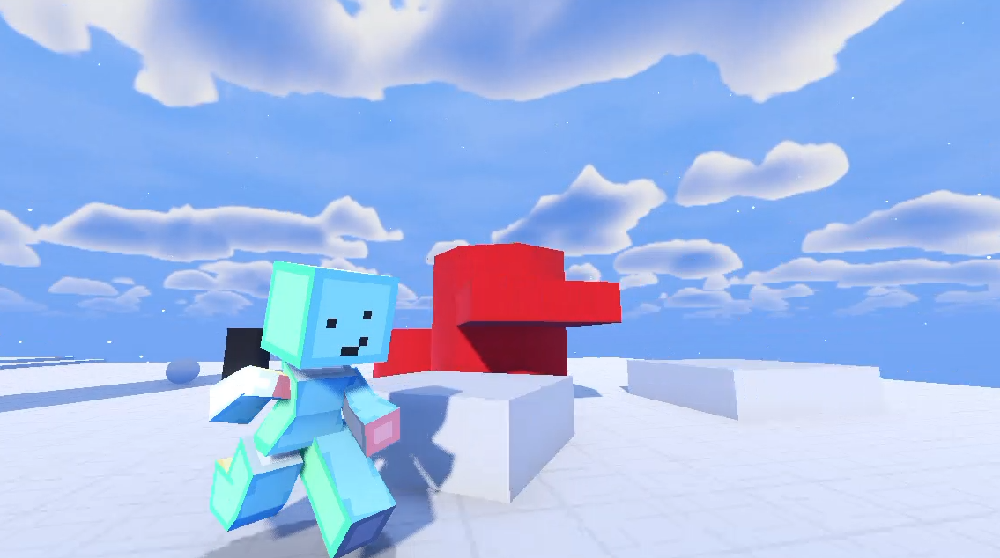
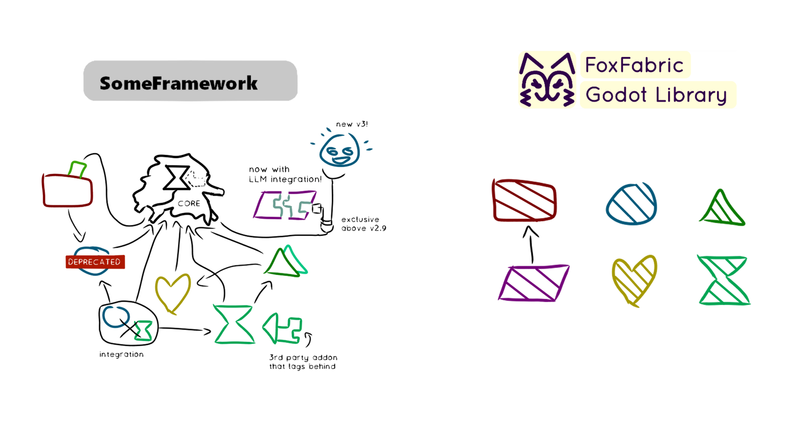

# FoxFabric

  

## Micro-addons for Godot

**FoxFabric is a lightweight, general purpose library for Godot 4,** built from small
independent micro-addons written in GDScript.

## Philosophy / Why?

This exists because I got sick of making the same underlying logic over and over.

The core ideas behind FoxFabric are:
- Simple
- Easy to maintain
- Fast to prototype

Heavy "frameworks" and bloat are something I vehemently dislike, which led me to make these many decoupled simple "micro-addons".

Inconsistency and conflicts suck! Everything in FoxFabric is meant to feel extremely *well integrated* into Godot and each micro-addon naturally does *not* conflict or create confusing overlap. 

Micro-addons may naturally synthesize based on how they were designed in the first place rather than tight coupling. In other words, addons are meant to have *very* specific jobs that make them easy to chain together.  

## Free and open source!

[MIT licensed](LICENSE). 

By tateorrtot. This is my personal library, so expect
things to change a looooootttt.

## Addons

| Name | Description | Maintained | Supports |
| --- | --- | --- | --- |
| [Template](https://github.com/tateorrtot/foxfabric-template) | Template for creating other FoxFabric addons. | ✅ | 4.7 | 

## Documentation

this is a WIP, a Read the Docs website is planned

## FoxFabric is inspired by the following:

[Minecraft's Fabric modding ecosystem](https://fabricmc.net/) 
- Modular
- Lightweight
- Rapid Updates

[UNIX philosophy](https://en.wikipedia.org/wiki/Unix_philosophy)
- Do one thing and do it well
- Expect the output of every program to become the input to another, as yet unknown, program
- Rapidly Prototype
- Tools make your life easier

[Godot best practices for engine contributions](https://contributing.godotengine.org/en/latest/development/engine/best_practices.html)
- The problem always comes first
- To solve the problem, it has to exist in the first place
- The problem has to be complex or frequent
- The solution must be discussed with others
- To each problem, its own solution
- Cater to common use cases, leave the door open for the rare ones
- Prefer local solutions
- Don't use complex canned solutions for simple problems